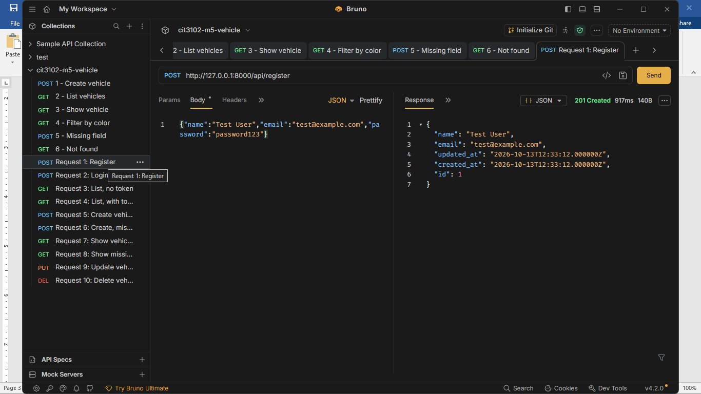
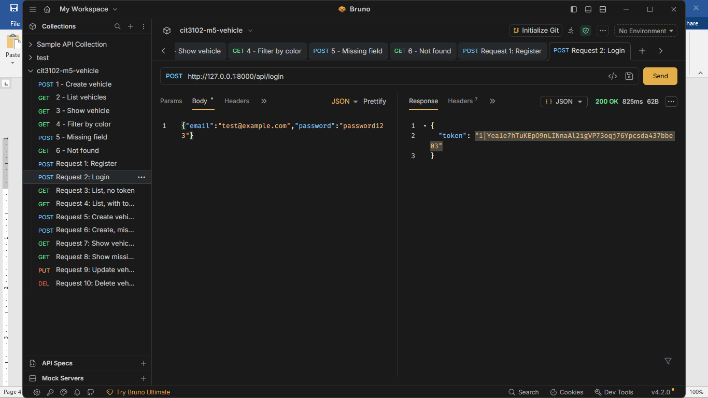
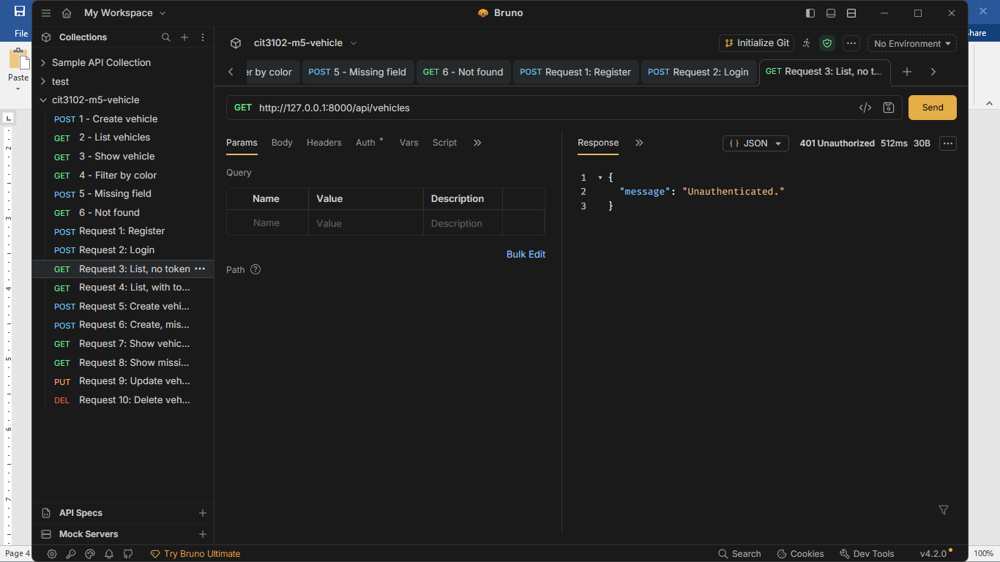
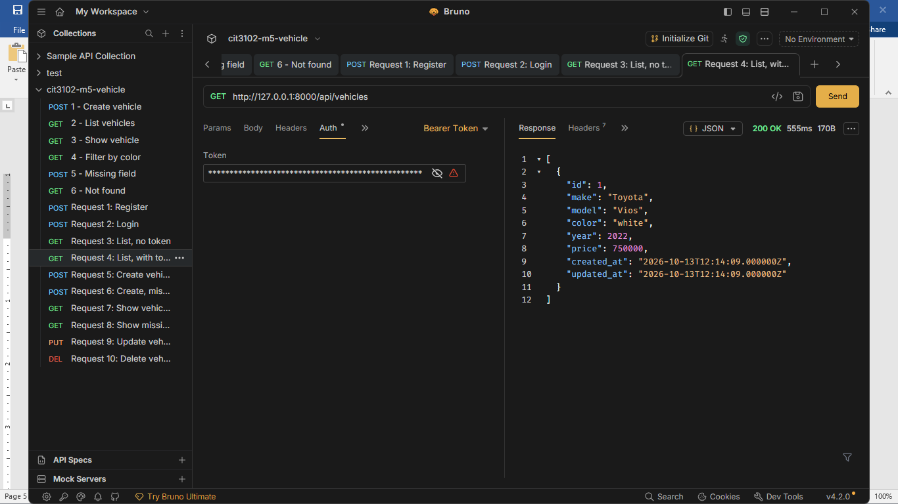
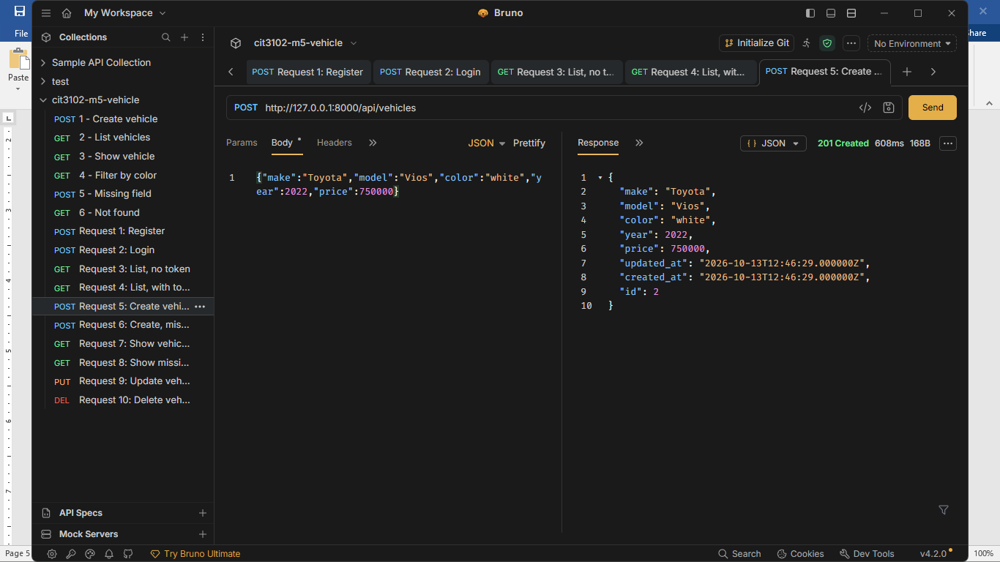
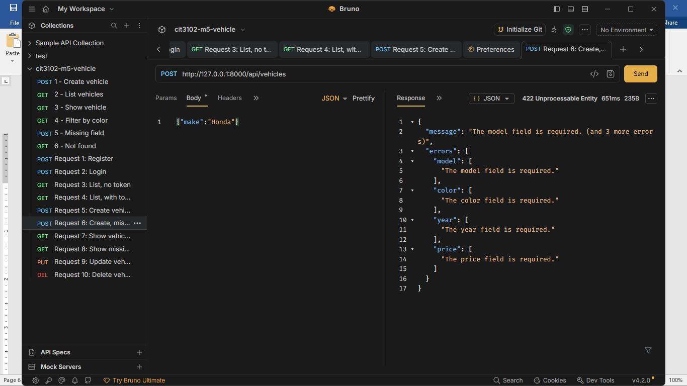
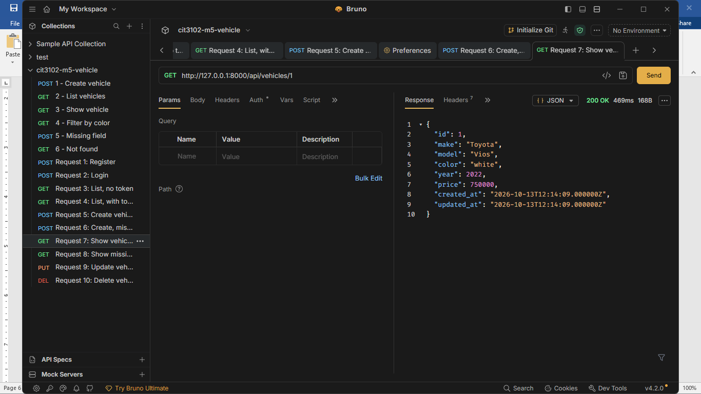
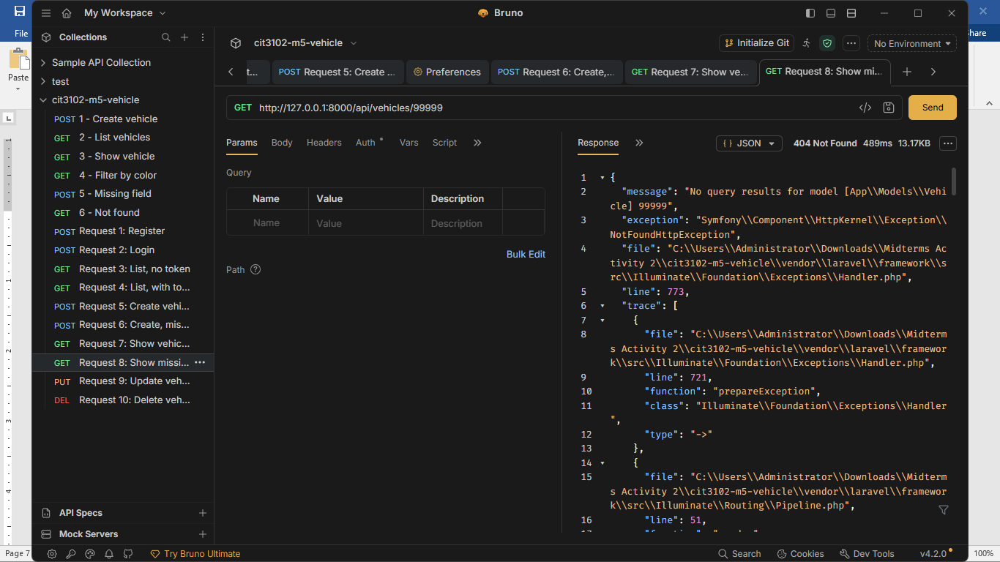
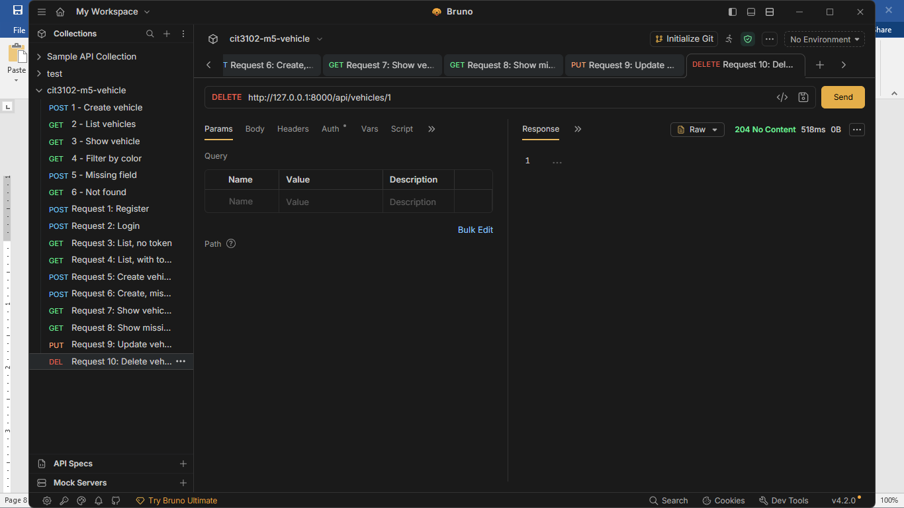

# Vehicle API

**Partners:** John Matthew Garrido
**Section:** IT1E
**Resource:** Vehicle (fields: make, model, color, year, price)

## Setup

```
git clone https://github.com/YeWang24/cit3102-m5-vehicle.git
cd cit3102-m5-vehicle
composer install
copy .env.example .env
php artisan key:generate
type nul > database\database.sqlite
php artisan migrate
php artisan serve
```

The API runs at http://127.0.0.1:8000. Send `Accept: application/json` with every request.

## Routes

| Verb | Path | What it does | Token needed? |
|---|---|---|---|
| POST | /api/register | Create a new user | No |
| POST | /api/login | Log in and get a token | No |
| POST | /api/logout | Delete the current token | Yes |
| GET | /api/me | Show the logged-in user | Yes |
| GET | /api/vehicles | List vehicles (filter by make, model, color) | Yes |
| POST | /api/vehicles | Create a vehicle | Yes |
| GET | /api/vehicles/{vehicle} | Show one vehicle | Yes |
| PUT | /api/vehicles/{vehicle} | Update a vehicle | Yes |
| DELETE | /api/vehicles/{vehicle} | Delete a vehicle | Yes |

## Screenshots

1. Register (201)


2. Login (200)


3. List with no token (401)


4. List with token (200)


5. Create vehicle (201)


6. Create with missing field (422)


7. Show vehicle 1 (200)


8. Show vehicle 99999 (404)


9. Update vehicle 1 (200)


10. Delete vehicle 1 (204)


## Why does DELETE return 204 and not 200?

[DELETE returns 204 because 204 means "No Content." The request was successful and the record is already deleted, so the server sends nothing back. A 200 response usually sends a record back as JSON, so there is something to read, but after a delete there is nothing left to send.]